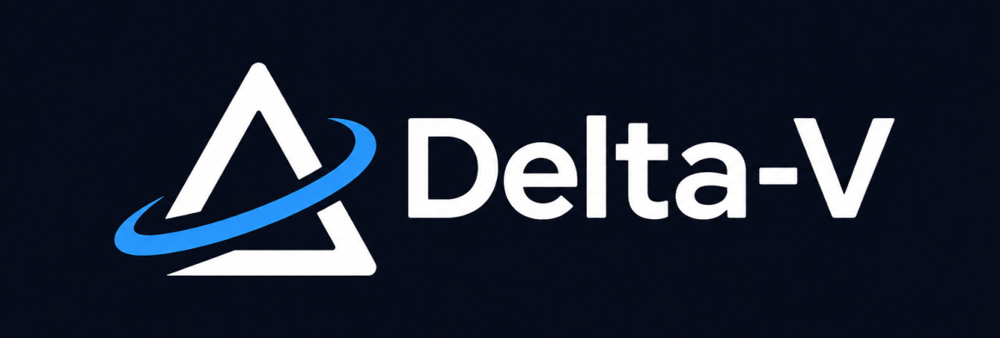
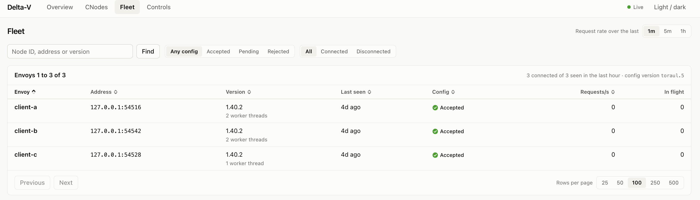
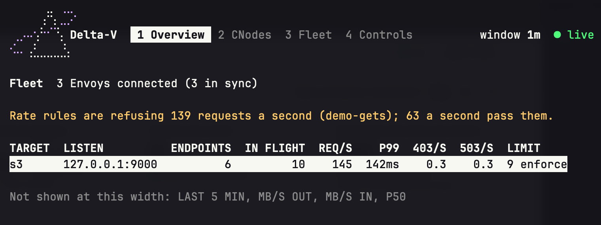
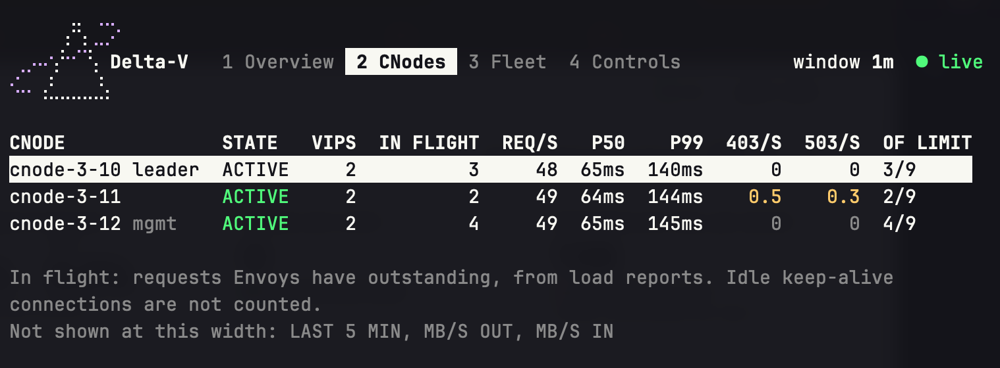

<p align="center">
  
</p>

# Delta-V

Delta-V is the control plane for a fleet of loopback Envoys that load-balance S3 traffic across
the VIPs of one or more VAST clusters, with no proxy machines in the data path. It serves
endpoints over xDS, collects telemetry from every Envoy over the streams Envoy opens, and shows
what the fleet and the CNodes are doing.

<p align="center">
  
</p>
<p align="center"><em>The web UI's Fleet page, one of its four; see <a href="#watch-it">Watch it</a>.</em></p>

<p align="center">
  
</p>
<p align="center"><em>The same daemon in a terminal: <code>deltav tui</code>.</em></p>

**Status: proof of concept; all eight milestones of the build plan are done, and request-rate
rules have been added since.** The daemon reads healthy endpoints from VAST clusters (or takes a
static list), serves them to Envoy over xDS and tracks every connected Envoy; it ingests Envoy's
access logs and load reports and keeps rolling per-endpoint, per-CNode and per-Envoy stats,
served by the `/api/v1` endpoints below and `/metrics`; a web UI, a terminal UI and the CLI all
read that API; connection limits, drain and rate rules act on the fleet; systemd units run the
daemon and the clients' Envoys; a test harness (`dvlab`) provides fake S3 backends, a mock VAST
API and a load generator. See [docs/DESIGN.md](docs/DESIGN.md).

**What is still open is listed in [docs/OPEN_ITEMS.md](docs/OPEN_ITEMS.md)**: what a review on
2026-11-18 found and how each finding was settled, what the first runs against a real cluster
turned up, and what has still never been run (the units under systemd).

The binary is `deltav`, also installed as `dv`; the two behave identically.

## Pinned versions

| Component | Version |
|---|---|
| Envoy (client hosts and test harness) | **1.40.2** |
| go-control-plane / Envoy API | v0.14.0 / v1.40.0 |
| Go | ≥ 1.26 (`go.mod` selects toolchain go1.27.4) |

## Build

```sh
make build        # bin/deltav and the bin/dv symlink
make test         # vet, license gate, tests
sudo make install # /usr/local/bin/deltav and dv
make dist         # release tarballs for Linux amd64 and arm64, in dist/
```

A release tarball holds the binaries built that way, static, so nothing has to be built or
installed to try it: unpack one and run `./demo.sh` (see "Try it without a VAST cluster").

`go build ./cmd/deltav` also works on its own: the web UI's stylesheet is committed. After
changing a page template or `internal/webui/tailwind.css`, run `make css`, which fetches the
pinned Tailwind standalone CLI (no Node) and regenerates it.

## Quick start

Ten minutes, given: a Linux host for the daemon that the clients can reach on TCP port 18000; a
VAST cluster with a VIP pool that serves S3, and a user who can read its management API; client
hosts that can reach that pool's VIPs.

**1. The daemon, on one host.**

```sh
make build && sudo make install     # the binary, deltav.service, /etc/deltav/deltav.env
sudo systemctl daemon-reload && sudo systemctl enable --now deltav
```

It listens for Envoys on `0.0.0.0:18000` and serves its API and web UI on `127.0.0.1:18080`.
(Without Go on that host, build elsewhere and copy `bin/deltav`; `deltav unit daemon` prints the
unit and `deltav unit daemon-env` the settings file.)

**2. A VAST cluster and a target.** The password is asked for if it is not in `DELTAV_PASSWORD`.

```sh
deltav vast add lab --host vast.example.com --user admin
deltav vast pools lab                                         # find the pool that serves S3
deltav target add s3 --cluster lab --pool main --port 80 --listen-port 9000
```

**3. Envoy on every client.** The daemon host makes the two files that every client gets, the
same on all of them:

```sh
deltav bootstrap --xds-address <daemon host>:18000 > envoy.json
deltav unit client > deltav-envoy.service
```

On each client (by hand here; a fleet gets them from its configuration management):

```sh
curl -fsSL -o envoy https://github.com/envoyproxy/envoy/releases/download/v1.40.2/envoy-1.40.2-linux-x86_64
echo "1d64506e25c1844f146162ddb2ece7010fa4e784faddb40a079021491f1f03cc  envoy" | sha256sum -c -
sudo install -m 0755 envoy /usr/local/bin/envoy
sudo install -D -m 0644 envoy.json /etc/deltav/envoy.json
sudo install -m 0644 deltav-envoy.service /etc/systemd/system/deltav-envoy.service
sudo systemctl daemon-reload && sudo systemctl enable --now deltav-envoy
```

(On arm64 the file is `envoy-1.40.2-linux-aarch_64` and its SHA-256
`b9d6d1e06dd5838a3506de9f4deebad3de9a2ce6cadb87cd76222ca286213baf`.)

**4. Use it.** On the daemon host, `deltav fleet list` shows each client by its host name once
its Envoy has connected and accepted the config. On a client, S3 is now at
`http://127.0.0.1:9000`, with path-style addressing:

```sh
aws configure set default.s3.addressing_style path
aws --endpoint-url http://127.0.0.1:9000 s3 ls s3://my-bucket/
```

**5. Watch it.** `deltav tui` on the daemon host, or the web UI: `ssh -L
18080:127.0.0.1:18080 <daemon host>` and open `http://localhost:18080/`. Limits and drain are
under Controls there, and described below.

The units: `deltav.service` runs the daemon as a user of its own whose only writable directory is
`/var/lib/deltav` (the state file there holds the VAST password). `deltav-envoy.service` runs
Envoy with the host's name as its name in the fleet, restarts it if it stops, and takes one
setting, `DELTAV_ENVOY_WORKERS` in `/etc/deltav/envoy.env` (default 2): Envoy's worker threads.
More threads carry more traffic; "Limits and drain" below says what they cost an enforced limit.
Restarting Envoy ends the S3 requests in flight through it. If the daemon is down, Envoys keep
their last config and S3 keeps working; only telemetry is lost.

## Attach a VAST cluster

```sh
deltav serve --state-dir /var/lib/deltav &          # the state file holds the VAST password, mode 0600

export DELTAV_PASSWORD='...'                         # or: --password-stdin < file
deltav vast add lab --host vast.example.com --user admin
deltav vast pools lab                                # pools, and how their VIPs spread over CNodes
deltav target add s3 --cluster lab --pool main --port 80 --listen-port 9000
deltav target list
```

Every Envoy then listens on `127.0.0.1:9000` and balances across the pool's VIPs that sit on
healthy CNodes. The daemon reads the cluster every 10 s with four GETs; it can issue nothing
but GETs and the token call. If VAST is unreachable, or the daemon restarts, Envoys keep being
served the last known endpoints. TLS verification of the VAST API is on unless the cluster is
added with `--insecure`.

### TLS to the VIPs

```sh
deltav target add s3 --cluster lab --pool main --port 443 --listen-port 9000 \
    --tls --tls-server-name s3.example.com --tls-ca-file /etc/pki/tls/certs/ca-bundle.crt
```

Envoy then speaks TLS to the VIPs; clients still speak plain HTTP to `127.0.0.1:9000`.

- **`--tls-server-name`** is sent as SNI and must be a name the certificate is for. A wildcard in
  the certificate covers one label, as everywhere.
- **`--tls-ca-file`** is the path, on the client hosts, of the CA bundle the certificate must
  chain to. It is required: Envoy cannot be told to use "the host's trust store" and has to be
  given the file. A host's own bundle is `/etc/ssl/certs/ca-certificates.crt` on Debian and
  Ubuntu and `/etc/pki/tls/certs/ca-bundle.crt` on RHEL and Fedora; a fleet of both needs one
  path that exists on all of them.
- **`--tls-insecure`** in place of the CA file verifies nothing. It is for a lab cluster that
  still has VAST's factory certificate, which is for `*.vastdata.com` and no name of yours.
- **When it is wrong**, every request gets a `503` from Envoy that says only "upstream connect
  error", and Envoy's log says nothing. The reason is in `deltav target list`, the TUI and the
  web UI's overview: for example *NO ANSWER FROM VAST for 412 requests in the last minute:
  VAST's certificate is not for the target's server name; it is for …*. The same line appears
  for any target Envoys cannot get an answer from: nothing listening, connections cut, timeouts.

## Limits and drain

```sh
deltav limit set s3 --per-cnode 400                  # alert: report CNodes over 400 connections
deltav limit set s3 --per-cnode 400 --mode enforce   # also cap every Envoy
deltav limit set s3 --per-cnode 0                    # remove the limit
deltav node drain cnode-3-11                         # withhold a CNode's VIPs from every Envoy
deltav node undrain cnode-3-11
```

A limit is the number of connections the whole fleet should hold to any one CNode for a target.
"Connections" are requests in flight, which is what Envoy reports: S3 over HTTP/1.1 holds one
request per connection, and idle keep-alive connections are not counted.

- **alert** (the default) reports CNodes over the limit in the API, the TUI and `/metrics`
  (`deltav_cnode_over_limit`). Nothing is enforced.
- **enforce** also gives each Envoy a cap on its connections to each VIP. Two things to know.
  The cap is each Envoy's own, so the limit is divided by the number of connected Envoys and by
  the most VIPs of the target that one CNode hosts, rounded down but never below 1: CNodes
  hosting fewer VIPs get less than the limit, and once Envoys times VIPs exceeds the limit the
  fleet can exceed it (alerting still reports that). At its cap an Envoy makes requests for that
  VIP wait; it does not send them elsewhere. And changing the cap makes every Envoy reconnect its
  connections for the target, so as Envoys come and go a new cap is pushed only when it differs
  by more than a fifth and not within a minute of the last (`serve --limit-min-change`,
  `--limit-min-interval`). A change you make yourself is pushed at once.

  And each worker thread of an Envoy can hold one connection to a VIP beyond its cap: Envoy
  lets a thread with no connection to a VIP open one, whatever the cap. The client unit tells
  the daemon how many threads its Envoy runs, and the cap is lowered by that number less one, so
  the limit holds; the price of more threads is a lower cap, and with too many for the limit
  (Envoys × VIPs on one CNode × threads above it) no cap can hold it, which the status says. An
  Envoy started some other way does not say how many threads it has, is counted as "workers
  unknown", and can exceed its cap by that number less one.

Drain is Delta-V's own setting: nothing changes on the VAST cluster. Envoys stop sending a
drained CNode new requests at once, and requests in flight finish. Limits and drains survive a
daemon restart.

## Request-rate rules

A rule limits the rate of the S3 requests it matches. The rules are
[tollbooth](https://github.com/blakegolliher/tollbooth)'s, and mean the same here.

```sh
deltav rule set uploads --operation PutObject,UploadPart --per-second 2000 --burst 4000 --per access_key
deltav rule set listings --operation 'List*' --per-minute 600 --per total
deltav rule set tenant-a --access-key AKIAEXAMPLE1 --bucket training-data --prefix ckpt/ --per-second 500 --per bucket
deltav rule set no-deletes --operation DeleteObject,DeleteObjects --bucket archive --blocked
deltav rule list                 # the rules, what each means in words, and what Envoys report
deltav rule show uploads         # which access keys it is refusing most
deltav rule refusals             # the latest requests rules refused: when, where, which rule, what
deltav rule remove listings
deltav rule operations           # the operation names a rule can use
```

- **What a rule matches.** `--operation` (S3 operation names, or a family such as `List*`),
  `--access-key`, `--bucket` and `--prefix` are filters; a request must pass all that are given.
  A prefix is compared with the object key, or with a listing's `prefix` parameter. The access
  key comes from the request's signature (header or presigned URL, SigV4 or SigV2); `-` is a
  request that carries none.
- **How a request is read.** As VAST reads it, so that a request cannot be put in a way a rule
  takes for one bucket and VAST serves from another. The path is percent-decoded once and then
  split, so `/arch%69ve/k` and `/archive%2Fk` are both key `k` in bucket `archive`. A bucket
  named in the host name counts the same as one in the path: for a target on a VAST pool the
  daemon reads the cluster's DNS suffix, and under it VAST takes the bucket from the host name
  (`archive.<pool>.<suffix>` or `archive.<suffix>`). A path that starts `//` has no bucket: VAST
  answers it as a listing of buckets. A request that names more than one access key (two
  `Authorization` headers, or a presigned URL with a header as well) is refused with `400
  InvalidRequest` while any rule looks at access keys, because which key VAST would act on is
  not for a rule to guess. All of this was established against one cluster, VAST 5.5; `make
  live` checks it against yours.
- **The limit.** One of `--per-second`, `--per-minute`, `--per-hour`, or `--blocked`. `--burst`
  is how many may pass at once after a quiet spell; by default the limit's own number, so 20 per
  hour lets 20 through together.
- **Counted per what.** `--per` is required: `total` (one count for everything the rule
  matches), or any of `access_key`, `bucket`, `prefix`, `client`.
- **Whose rate it is.** The whole fleet's. An Envoy on one client host cannot see the others, so
  each reports to the daemon what it let through and refused, and the daemon gives it a share of
  the rate: what it asks for while there is enough, an even split among those asking for more
  when there is not. Envoy reports every 5 seconds, so when traffic moves from one host to
  another the shares follow within that; in between, the fleet can run over or under for a few
  seconds. No request waits for the daemon. With `client` in `--per`, every client host has the
  whole rate to itself instead.
- **What a refused request gets.** `503` with S3's own `SlowDown` error document and
  `Retry-After: 1`, which every S3 SDK treats as throttling and retries; `--respond 429` for
  clients that want that. An upload that is refused also has its connection closed, as a
  server must when it answers before reading the body; the client's retry opens another.
- **Several rules.** A request that matches several rules must be allowed by each. At most 4
  rules can limit one request: if it matches more, the first 4 in the order of `rule list`
  count. A blocked rule refuses wherever it comes in the order. A request that one rule
  refuses has already been counted by the rules before it in that order.
- **What a rule does not cover.** A prefix rule matches a listing by the listing's own
  `prefix`, so listing a parent prefix still shows the names of keys under a blocked one (not
  their contents). And each operation is its own: a rule on `DeleteObject` leaves a batch
  delete, `DeleteObjects`, alone, which is how SDKs delete many keys.
- **When a change takes effect.** On the next request of every connection, open or new: within
  a moment of the command returning, on every client host.
- **Whether the burst holds.** Every Envoy that has a count open must be allowed at least one
  request at a time. So when more Envoys share one count than the rule's burst, that many can
  pass at once, not the burst; `rule list` and both UIs say so for the rule. The rate is kept
  regardless.
- **What is counted.** A request is counted for what it claims to be, before VAST checks its
  signature. Someone who knows an access key ID can therefore use up that key's limit with
  requests VAST will reject. Where that matters, add `client` to `--per`.
- **Refusals are not the target's traffic.** A refused request never reaches VAST. It is left
  out of the target's request counts, its 503s and its latency, and out of each client host's;
  it is counted under its rule, and per target as "refused". The daemon also remembers the
  latest thousand refusals one by one (`deltav rule refusals`, `/api/v1/refusals`).
- **If the daemon is away.** Blocked rules go on refusing. For a limit, each Envoy keeps the
  share it had, so the fleet holds the rule as it stood; shares last ten minutes, and after
  that limits are not enforced until the daemon is back. A count first opened while the daemon
  is away is not limited either.

Tried against a real cluster (VAST 5.5) through Envoy, with the AWS CLI 2.15.31 and boto3
1.41.3 at their default settings: multipart uploads and ranged downloads of 64 MiB, server-side
copies, listings page by page, presigned URLs, single and batch deletes, and boto3 addressing
the bucket by host name all work, and every request was counted under the operation, bucket
and access key it should be. Under a limit the two clients differ:

| Limit | AWS CLI, default | AWS CLI, `AWS_RETRY_MODE=adaptive AWS_MAX_ATTEMPTS=10` | boto3, default |
|---|---|---|---|
| `UploadPart` at 2 a second, a 64 MiB upload in 8 parts | gives up after 3 s (`reached max retries: 2`) and aborts the upload, leaving nothing behind | done in 6 s | done in 3 s |
| `List*` at 1 a second, 300 keys in 6 pages | gives up on a page | done in 13 s | done in 6 s |

How the AWS CLI takes a refusal, in more detail, tried with version 2.15.31 against these rules
and test backends:

- It reads Envoy's answer as S3 throttling (`SlowDown`) and retries it, but in its default
  mode only twice, each after less than a second, and it does not wait for `Retry-After`. Against a rule
  of 5 uploads a second, one `aws s3 cp --recursive` of 40 small files (the CLI sends 10 at a
  time) gave up on 11 of them and exited 1.
- With `AWS_RETRY_MODE=adaptive`, or `AWS_MAX_ATTEMPTS=10`, the same copy uploaded all 40 and
  exited 0, in 9 and 13 seconds: at 5 a second, 8 is the least it could take. Adaptive mode
  slows itself to the rate it is given; more attempts simply try for longer.
- A burst at least as large as the client's concurrency lets a short run through whole: ten
  fetches at once against 2 a second all succeeded with `--burst 10`, three failed with
  `--burst 2`.
- It does **not** retry a `429`. A rule with `--respond 429` therefore fails a request on its
  first refusal, whatever the retry settings. That suits a blocked rule, which fails at once
  instead of after three tries; for a rate, leave the answer at 503.

A per-hour limit refuses for long stretches, longer than any SDK keeps retrying.

The `source_ip` of tollbooth's rules has no counterpart here: Envoy sits on the client host, so
the source is always loopback. `--per client` is the nearest thing.

## Watch it

The daemon serves a web UI on its HTTP address, `http://127.0.0.1:18080/` by default. It has four
pages, kept current without reloading:

- **Overview**: Envoys connected and their config state; requests, megabytes and 403/503 share
  across all targets; CNodes over a limit; then a row per target.
- **CNodes**: state as VAST reports it, VIPs hosted, requests in flight against each limit,
  rates, latency and a five-minute sparkline. Open a row for its VIPs.
- **Fleet**: every Envoy with version, last seen, config state (and Envoy's reason if it
  rejected the config) and request rate. Search, filter, sort and paging are done by the daemon,
  so the page is the same size with five thousand Envoys as with five.
- **Controls**: set or remove a target's limit, drain and undrain CNodes, attach and detach
  VAST clusters, add and remove targets.

It follows the system's light or dark setting; the button in the top bar overrides that. From
another machine, tunnel to it: `ssh -L 18080:127.0.0.1:18080 <daemon host>`, then open
`http://localhost:18080/`.

A daemon bound to anything but loopback requires a token (`DELTAV_API_TOKEN`), and the UI then
asks for it once and keeps a 12-hour session cookie. Use a long random token, and put TLS in
front of the daemon if the network is not trusted: it speaks plain HTTP. A daemon with no token
answers only to loopback names (`127.0.0.1`, `localhost`), and in both cases a request that
changes anything is refused if a browser says it comes from another site's page.

```sh
deltav tui                    # live terminal UI
deltav node list --vips       # CNodes with state, VIPs, requests in flight, rates and latency
deltav fleet list --sort request_rate --desc --limit 20
deltav fleet list --state nacked     # Envoys that rejected the config, with Envoy's reason
```

The terminal UI has four views, switched with `1`-`4` or `tab`: **Overview** (per target:
endpoints, requests in flight, request and byte rates, 403s and 503s, latency, a five-minute
sparkline), **CNodes** (the same per CNode; `enter` shows its VIPs), **Fleet** (every Envoy; `/`
filters, `s` sorts, `a` and `c` narrow by config state and connection, `pgup`/`pgdn` page; the
daemon does the paging, so it stays quick with thousands of Envoys) and **Controls** (attached
clusters, targets and CNodes; `e` sets a target's limit, `m` switches it between alert and
enforce, `d` drains or undrains a CNode, `?` shows the notes on limits). `w` cycles the window
between 1m, 5m and 1h; `q` quits. It follows the daemon's event stream and uses the terminal's
own colors, so it suits light and dark themes. In a narrow terminal (it is usable at 80 by 24)
a table leaves out its least needed columns, and says which, rather than cut its rows short.

<p align="center">
  
</p>
<p align="center"><em>The CNodes view, with requests in flight against a limit of 9.</em></p>

All three take `--api` (default `http://127.0.0.1:18080`, or `DELTAV_API`) and, for a daemon
that requires it, `DELTAV_API_TOKEN`. The list commands take `--json`.

## Try it without a VAST cluster

One script runs the whole arrangement on a Linux host: six fake S3 backends as the VIPs of a
mock VAST cluster, the daemon, three real Envoys and a steady load. It prints where the web UI
is and a few commands to try, and Ctrl-C stops all of it.

```sh
make build && scripts/demo.sh        # in a release tarball: ./demo.sh
```

It fetches the pinned Envoy binary if `make envoy` has not, and checks it. The ports it uses,
and how to move them, are at the top of the script.

The same by hand, a piece at a time. On Linux every `127.x.y.z` address is loopback, so fake
backends can share one port the way VIPs do.

```sh
make build envoy                      # also fetches and verifies the pinned Envoy binary
export AWS_ACCESS_KEY_ID=dvlab AWS_SECRET_ACCESS_KEY=dvlab-secret   # any pair; the fake verifies it

bin/dvlab fakes3 --listen 127.0.0.11:9100,127.0.0.12:9100,127.0.0.13:9100 &
bin/deltav serve --state-dir ./state --static-target s3:9000:127.0.0.11:9100,127.0.0.12:9100,127.0.0.13:9100 &
bin/deltav bootstrap --xds-address 127.0.0.1:18000 > bootstrap.json
.cache/envoy/envoy-1.40.2-linux-x86_64 -c bootstrap.json --service-node "$(hostname)" \
    --concurrency 2 --config-yaml 'node: {metadata: {deltav_workers: 2}}' &   # as the client unit does

curl -s 127.0.0.1:18080/api/v1/fleet  # the Envoy, its version and whether it accepted the config
bin/dvlab loadgen --endpoint http://127.0.0.1:9000 --bucket lab --requests 1000 \
    --special-keys --expect --check   # through Envoy; fails if Host, path, Expect or body changed
```

To try clusters, CNodes, limits and drain as well, put the mock VAST API in front of six fake
backends (it serves a real cluster's sanitized responses; pool `main` has six VIPs on three CNodes):

```sh
IPS=127.0.0.11,127.0.0.12,127.0.0.13,127.0.0.14,127.0.0.15,127.0.0.16
bin/dvlab fakes3 --listen ${IPS//,/:9100,}:9100 &
bin/dvlab mockvast --pool-vips main=$IPS &          # prints its address and the command to attach it
bin/deltav serve --state-dir ./state &
DELTAV_PASSWORD=mock-password bin/deltav vast add mock --host 127.0.0.1:<port it printed> --user admin --insecure
bin/deltav target add s3 --cluster mock --pool main --port 9100 --listen-port 9000
```

Then start Envoy and the load generator as above and open `http://127.0.0.1:18080/`.

`make integration` runs the same arrangement as tests, with real Envoy processes, including one
where a mock VAST (a real cluster's sanitized responses) supplies the endpoints. `make live
ENV=<file>` does it on real equipment: a real VAST cluster, real Envoy, and round trips against a
real bucket; then it asks VAST for one object in about fifty unusual ways and checks that
every way VAST serves is caught by a rule that should catch it. See the Makefile.

## HTTP API and metrics

The API is JSON under `/api/v1` on the HTTP listener (`127.0.0.1:18080` by default; a bearer token
is required when it is bound elsewhere). Stats take `?window=1m|5m|1h`.

| Path | What it returns |
|---|---|
| `/api/v1/overview` | Per target: endpoints served, requests in flight, request and byte rates, status counts with 403 and 503 broken out, p50/p90/p99, and apart from all of those the requests rate rules refused. Fleet counts. |
| `/api/v1/targets` | The targets and endpoints being served to Envoys, and how each VAST target resolved; and for a target whose requests Envoys are answering themselves because VAST gives no answer (`no_answer`), why, on which client last, and how many in the last minute. `POST` adds one, `DELETE /api/v1/targets/{name}` removes it. |
| `/api/v1/vast` | Attached VAST clusters and the state of their polling. `POST` attaches one (the password is never returned), `DELETE /api/v1/vast/{name}` detaches it; `/api/v1/vast/{name}/pools` lists its VIP pools. |
| `/api/v1/cnodes` | Per CNode: state from VAST, whether it is drained, VIPs hosted, requests in flight against each target's limit, and the same stats, with a row per VIP beneath. |
| `/api/v1/targets/{name}/limit` | `PUT` sets a target's per-CNode limit and mode; `DELETE` removes it. |
| `/api/v1/vast/{cluster}/cnodes/{cnode}/drain` | `POST` drains a CNode; `DELETE` undrains it. |
| `/api/v1/rules` | The request-rate rules in the order they apply, each with what it means in words and what Envoys last reported (allowed and refused per second, and the access keys, buckets or prefixes it is refusing most). `PUT /api/v1/rules/{name}` adds or replaces one, `DELETE` removes it; `/api/v1/s3-operations` lists the operation names. |
| `/api/v1/refusals` | The latest requests rules refused, newest first (`?limit=`, default 100, at most the 1,000 the daemon remembers): time, client host, target, rule, operation, access key, bucket and the status answered. |
| `/api/v1/endpoints` | The same stats per endpoint (VIP); `?target=` narrows it. |
| `/api/v1/fleet` | Envoys with version, last seen, config state and stats. `?limit=&offset=`, `?sort=node_id\|request_rate\|last_seen\|connected_at\|envoy_version\|config_state\|address`, `?order=asc\|desc`, `?q=` (substring), `?state=acked\|nacked\|pending`, `?connected=true\|false`. |
| `/api/v1/fleet/{node}` | One Envoy, every window. |
| `/api/v1/events` | Server-sent events: the overview, every `?interval=` (default 2s). |
| `/api/v1/settings` | How the daemon was started, as far as a UI needs it: the enforce-mode debounce, the VAST poll interval, whether a token is required. |

"In flight" is the number of requests Envoys have outstanding to an endpoint, from load reports.
S3 over HTTP/1.1 holds one request per connection, so it is the count of busy connections; idle
keep-alive connections are not included.

`/metrics` exports the same data as cumulative Prometheus series, so one scrape covers the fleet:
`deltav_endpoint_requests_total{target,endpoint,cnode,class}`,
`deltav_endpoint_responses_total{...,code="403"|"503"}`, `deltav_endpoint_bytes_total{...,direction}`,
`deltav_endpoint_request_duration_seconds` (histogram), `deltav_endpoint_in_flight_requests`,
`deltav_endpoint_overflow_total`, `deltav_endpoint_load_issued_total`,
`deltav_endpoint_load_completed_total{...,result}`, `deltav_fleet_members{state}`,
`deltav_fleet_config{state}`, `deltav_target_endpoints{target}`, and for limits and drain
`deltav_target_cnode_limit{target,mode}`, `deltav_target_limit_share{target}`,
`deltav_cnode_in_flight_requests{target,cluster,cnode}`, `deltav_cnode_over_limit{...}` and
`deltav_cnode_drained{cluster,cnode}`, and for rate rules
`deltav_rate_limit_requests_total{rule,result="allowed"|"denied"}`,
`deltav_rate_limit_keys{rule}` and `deltav_target_refused_total{target}`. A request a rule
refused is in the last of these and in none of the `deltav_endpoint_*` series. Per-Envoy series
(`deltav_member_*`) are off unless the daemon runs with `--metrics-per-member`.

## S3 clients

Clients point at `http://127.0.0.1:<listen port>` and **must use path-style addressing**
(`/bucket/key`): the host is a loopback address, so there is no bucket subdomain. Envoy passes the
`Host` header, the path and `Expect: 100-continue` through unchanged, so SigV4 signatures made for
the loopback address verify at the backend.

## Known gaps

These are out of scope for the POC:

- No mutual TLS on the xDS and telemetry streams. Anything that can reach the gRPC port can read
  config and send telemetry.
- No high availability for the daemon. Envoys keep their last config while it is down.
- No per-group targeting: every Envoy receives every target.
- No long-term metric storage. Windows are kept in memory for up to 1 h; scrape `/metrics` for
  history.

## Licensing

Delta-V is MIT-licensed; see [LICENSE](LICENSE). Third-party licenses are listed in [THIRD_PARTY_LICENSES.md](THIRD_PARTY_LICENSES.md) and audited
in [docs/LICENSE_AUDIT.md](docs/LICENSE_AUDIT.md).
